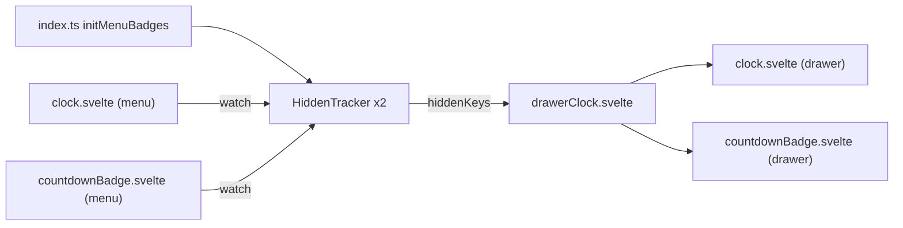

# ドロワーの時計ブロック

## 概要

上部メニューで隠れた時計とカウントダウンを、右のドロワーの先頭のブロックへ移す。隠れたかどうかは、メニューのバッジの各部分を `IntersectionObserver` で見張って決め、幅は測らない。見張りの結果は `HiddenTracker` だけが持ち、メニューのバッジが書き、ドロワーのブロックが読む。



## 関連

- 使う: [`clock.md`](./clock.md) — 時計の描画と `initMenuBadges`。ドロワー用の形は `layout` で切り替える
- 使う: [`countdownBadge.md`](./countdownBadge.md) — カウントダウンの描画。ドロワー用の形は `layout` で切り替える
- 使う: [`../ui/quickDrawer.md`](../ui/quickDrawer.md) — `DRAWER_REGION_SELECTOR` とブロックの外枠 `DrawerBlock.svelte`
- 資料: [`../../moodle/drawer.md`](../../moodle/drawer.md) — ドロワーの構造

## 対象ファイル

| パス | 役割 |
|---|---|
| `src/features/menu/visibility.svelte.ts` | 要素を見張り、隠れているものの鍵を控える `HiddenTracker` |
| `src/features/menu/drawerClock.svelte` | ドロワーの「時計」ブロックの描画 |
| `src/features/menu/clock.svelte` | 時計。`layout` と `watch` を受け取る |
| `src/features/menu/countdownBadge.svelte` | カウントダウン。`layout` と `watch` を受け取る |
| `src/features/menu/index.ts` | 見張り役を作り、バッジとブロックへ渡してマウントする |
| `src/entrypoints/shared.content.ts` | ドロワーを隠す設定を読み、`initMenuBadges` へ渡す |

## インターフェース

```ts
// visibility.svelte.ts
export class HiddenTracker<K> {
  // 要素を見張る attachment を返す。this を束縛してあり、関数のまま渡せる
  watch: (key: K) => Attachment;
  // 隠れている要素の鍵。$state と同じく反応する
  get hiddenKeys(): Set<K>;
  disconnect(): void;
}
```

```ts
// drawerClock.svelte の Props
interface Props {
  clock: ClockConfig;
  periodTable: PeriodSlot[];
  targets: CountdownTarget[];
  thresholds: CountdownThresholds;
  hiddenClock: HiddenTracker<string>;
  hiddenCountdowns: HiddenTracker<string>;
}
```

`clock.svelte` と `countdownBadge.svelte` が受け取る `layout` と `watch` は、それぞれの指示書の Props にある。`initMenuBadges` の `drawer` 引数は [`clock.md`](./clock.md) にある。

## 処理の流れ

### 見張りの準備

1. `initMenuBadges` が、`drawer` が true で `DRAWER_REGION_SELECTOR` の要素がある時だけ、時計用とカウントダウン用の `HiddenTracker<string>` を1つずつ作る。無い時は作らず、バッジへ `watch` を渡さない
2. `ctx.onInvalidated` で両方の `disconnect` を呼ぶ
3. 時計とカウントダウンのバッジへ、それぞれの `watch` を渡してマウントする
4. ドロワーのブロックを `createShadowRootUi` で差し込む

| 設定 | 値 |
|---|---|
| `name` | `mimo-drawer-clock` |
| `position` | `inline` |
| `anchor` | `DRAWER_REGION_SELECTOR` の要素 |
| `append` | `before` |

### 見張る要素

| バッジ | 鍵 | 要素 |
|---|---|---|
| 時計 | `clock` | ルートの要素（360px 未満で消える） |
| 時計 | `period` | 時限（768px 未満で消える）。時限を出している間だけある |
| 時計 | `date` | 日付と曜日（640px 未満で消える）。日付か曜日を出す設定の時だけある |
| カウントダウン | 対象の `id` | 各対象の要素。「授業終了」の要素も含む |

要素は `{@attach watch(鍵)}` で見張る。要素が描画から外れると、attachment の後始末で見張りと控えを外す。時限のように時刻で現れたり消えたりする要素も、現れた時点から見張る。

### HiddenTracker

1. `IntersectionObserver` を、根をビューポート（`root` を指定しない）、`threshold` を `0.99` で作る
2. 通知のたびに、`isIntersecting` が true で `intersectionRatio` が `0.99` 以上の要素を「見えている」とし、控えから外す。それ以外は「隠れている」とし、要素と鍵を控える
3. 控えは `SvelteMap<Element, K>` に持つ。`hiddenKeys` は控えの鍵を `Set` にまとめて返す

`IntersectionObserver` は、`display: none` の要素を交差なし（割合 0）として通知する。祖先の `overflow` による切り取りも交差の計算に入る。カウントダウンの2行目へ折り返した件は、外側の要素の `h-12 overflow-hidden` で切られて割合 0 になる。Shadow DOM の中の要素も見張れる。

### drawerClock.svelte

1. 時計用の `hiddenKeys` が空でなければ、時計を隠れているとみなす
2. `targets` から、カウントダウン用の `hiddenKeys` に `id` がある対象だけを残す
3. どちらも無ければ何も置かない
4. あれば `DrawerBlock` に見出し「時計」を付けて置き、中へ上から時計、カウントダウンの順に縦に積む（`flex flex-col gap-2`）
5. 時計は `layout="drawer"` で、設定で表示する段をすべて出す。カウントダウンは残した対象だけを `layout="drawer"` で出す

## 決めごと

- **隠れたかどうかを `IntersectionObserver` で決め、幅を JS で測らない。** メディアクエリで消える時計と、CSS の折り返しで消えるカウントダウンを、同じ1つの方法で扱える。消える条件は CSS が持ったままにでき、JS へ写さずに済む
- **一部だけ切れた要素も隠れているとみなす（`threshold` 0.99）。** メニューの CSS は、入りきらない件を切れた姿で残さない作りのため、それと揃える。1 ちょうどにしないのは、端数の丸めで割合が 0.999 になる場合があるため
- **根をビューポートにする。** 上部メニューは画面の上端に固定されており、スクロールで外れない。メニューの要素を根にすると、Shadow DOM の外の要素を中から指すことになる
- **時計は一部でも隠れたら、ブロックに時計をすべて出す。** 時刻だけ、日付だけを別の場所に分けて出すと、読む場所が2つに割れる
- **カウントダウンは隠れた件だけを出す。** メニューに出ている件を重ねて出すと、同じ情報が2箇所に並ぶ
- **見張りの結果は `HiddenTracker` だけが持つ。** メニューのバッジとブロックがそれぞれ状態を持つと、食い違う。ブロックは読むだけにする
- **ブロックは `#block-region-side-pre` の直前に置く。** ピン留めのブロックは並びの中の先頭へ入るため、どちらが先に差し込まれても時計が上に来る
- **何も隠れていない間は、ブロックの中身を置かない。** 差し込み先の Shadow DOM は残るが、中身が無いため面積を取らない
- **ドロワーを隠す設定の間と、ドロワーの無いページでは見張らない。** 移す先が無いため、隠れたものは今までどおり消えるだけにする
- **時計とカウントダウンの描画は、メニューと同じコンポーネントを `layout` で切り替えて使う。** 書式と時限の判定を2箇所に持たない
