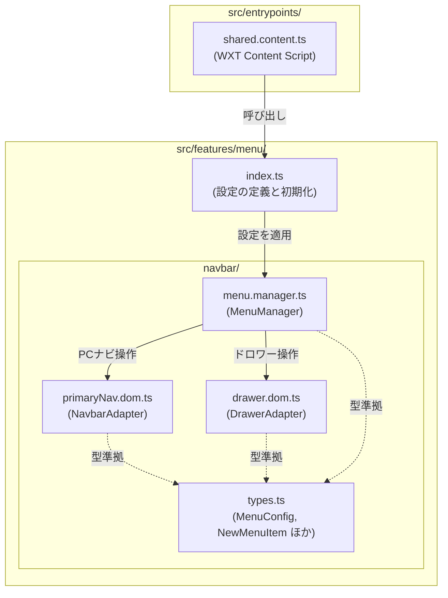

# navbar モジュール

## 概要

Moodle のナビゲーションメニューに対して、項目の非表示と追加を行う。PC表示のトップバーとモバイル表示のドロワーはマークアップが大きく異なるため、その差を `MenuAdapter` インターフェースの下に隠し、呼び出し側が表示モードを意識せず同じ設定で両方を操作できるようにする。



## 関連

- 資料: [`docs/moodle/navbar.md`](../../moodle/navbar.md) — 操作対象のDOM構造とセレクタ。アダプターを触る前に読む
- 参考: [`clock.md`](./clock.md) — 同じナビゲーションメニューに載るバッジ。あちらは Shadow DOM へ Svelte を注入する別方式
- 参考: [`countdownBadge.md`](./countdownBadge.md) — 同上

## 対象ファイル

| パス | 役割 |
|---|---|
| `src/features/menu/navbar/types.ts` | `MenuAdapter` / `MenuConfig` / `NewMenuItem` / `InsertPosition` の型定義 |
| `src/features/menu/navbar/menu.manager.ts` | `MenuManager`。全アダプターへ操作をブロードキャストする |
| `src/features/menu/navbar/primaryNav.dom.ts` | `NavbarAdapter`。PC表示のトップバーを操作する |
| `src/features/menu/navbar/drawer.dom.ts` | `DrawerAdapter`。モバイル表示のドロワーを操作する |
| `src/features/menu/index.ts` | 設定オブジェクトを定義し、`MenuManager` へ渡して初期化する |

## インターフェース

```ts
// types.ts
export interface InsertPosition {
  target: string;
  where: "before" | "after";
}

export interface NewMenuItem {
  text: string;
  href: string;
  newTab?: boolean;
  position?: InsertPosition;
}

export interface MenuConfig {
  hidden?: string[];
  items?: NewMenuItem[];
}

export interface MenuAdapter {
  readonly isReady: boolean;
  hideItem(target: string): boolean;
  insertItem(item: NewMenuItem): boolean;
}
```

```ts
// menu.manager.ts
export class MenuManager {
  // 既定値は [new NavbarAdapter(), new DrawerAdapter()]
  constructor(adapters?: MenuAdapter[]);

  ensureStyle(): void;
  applyConfig(config: MenuConfig): void;
  hideItem(target: string): boolean;
  insertItem(item: NewMenuItem): boolean;
}

export { MenuManager as NavbarManager };
export * from "./types";
```

```ts
// primaryNav.dom.ts
export class NavbarAdapter implements MenuAdapter {
  constructor();
}
```

```ts
// drawer.dom.ts
export class DrawerAdapter implements MenuAdapter {
  constructor();
}
```

`hideItem` と `insertItem` の戻り値は「1つ以上のアダプターが処理できたか」を表す。

呼び出し側（`src/features/menu/index.ts`）での使い方:

```ts
const config: MenuConfig = {
  hidden: ["Office365", "Google", "旧Moodle"],
  items: [
    {
      text: "シラバス",
      href: "https://example.com/syllabus",
      newTab: true,
      position: { target: "マイコース", where: "after" },
    },
  ],
};

new MenuManager().applyConfig(config);
```

## 処理の流れ

### MenuManager.applyConfig

1. `ensureStyle()` を呼ぶ
2. `config.hidden` の各文字列について `hideItem()` を呼ぶ
3. `config.items` の各要素について `insertItem()` を呼ぶ
4. アダプターのいずれかが未 ready で、かつ `document.readyState === "loading"` の場合、`DOMContentLoaded` で 2〜3 を1度だけ再実行する

### MenuManager.ensureStyle

1. `document.getElementById("mimo-menu-style")` が存在すれば何もしない
2. `<style id="mimo-menu-style">` を作り、`[data-mimo-hidden] { display: none !important; }` を入れる
3. `document.head`（無ければ `document.documentElement`）へ追加する

### アダプター共通

- コンテナはコンストラクタで取得する。以後は `isConnected` が false になった時点で取り直す
- `isReady` はコンテナの再取得を伴う。単なる状態の読み取りではない
- `hideItem` / `insertItem` はコンテナを取得できなければ false を返す

### NavbarAdapter

コンテナのセレクタ: `nav.navbar ul.more-nav, nav.navbar ul.navbar-nav`

**hideItem**

1. `:scope > li.nav-item` を走査し、照合にヒットした要素へ `data-mimo-hidden="true"` を付ける
2. `.dropdown-menu a.dropdown-item` を走査し、同様に処理する
3. 1件でもヒットすれば true を返す

**insertItem**

1. `<li class="nav-item" role="none">` を作り、中へ `<a role="menuitem" class="nav-link">` を入れる
2. `newTab` が true なら `target="_blank"` と `rel="noopener noreferrer"` を付ける
3. `position` があれば、トップレベル項目から照合でターゲットを探し、`before` / `after` に応じて挿入する
4. 挿入できなかった場合、`li.dropdownmoremenu` があればその前へ、無ければ末尾へ追加する

### DrawerAdapter

コンテナのセレクタ: `#theme_boost-drawers-primary .drawercontent .list-group, #theme_boost-drawers-primary .list-group`

ドロワーでは項目が `li` ではなく `a.list-group-item` としてコンテナの直接の子に並ぶ。アコーディオンの中身は `.collapse` 要素として兄弟位置に置かれる。

**hideItem**

1. コンテナの直接の子のうち `.collapse` を持たない要素を走査し、ヒットしたら `data-mimo-hidden="true"` を付ける
2. ヒットした要素がアコーディオンのトグルなら、対応する `.collapse` 要素にも同じ属性を付ける。トグルの判定は次のいずれかを満たすこと
   - `data-toggle="collapse"` または `data-bs-toggle="collapse"` を持つ
   - `data-target` または `data-bs-target` を持つ
   - 次の兄弟要素が `.collapse` を持つ
3. 対応する `.collapse` 要素は、`data-target`（または `data-bs-target`）のセレクタ → 次の兄弟要素 → `aria-controls` の id、の順に探す
4. `.collapse a.list-group-item` を走査し、ヒットしたら同様に属性を付ける

**insertItem**

1. `<a class="list-group-item list-group-item-action">` を作る
2. `newTab` の扱いは NavbarAdapter と同じ
3. `position` の `after` では、ターゲットの次に `.collapse` 要素がある場合、その後ろへ挿入する
4. 挿入できなかった場合は末尾へ追加する

### 照合ロジック

両アダプターとも同じ順序で評価し、ヒットした時点で true を返す。

1. `data-key` 属性 — 完全一致、または双方を小文字化しての一致
2. `href` — 部分一致。小文字化した比較も行う
3. `textContent` — 部分一致。前後の空白を除き、小文字化して比較する

アダプターごとの違い:

| | NavbarAdapter | DrawerAdapter |
|---|---|---|
| 入れ子を持つ要素 | `.dropdown-menu` を内包する場合、主リンク（`:scope > a, a.nav-link, a`）のみを照合対象にする。内包しない場合は要素内の全 `<a>` の href を照合する | `.collapse` クラスを持つ要素そのものは照合対象外 |
| href の除外 | なし | `#` または `#` 始まりの href は照合しない |
| テキストの正規化 | ドロップダウンでは主リンクのテキストのみ使う | 子要素を持たない場合は `textContent` をそのまま使う。持つ場合は `.collapse` / `.sr-only` / `.visually-hidden` を除いたクローンから取得し、「折りたたむ」「展開する」を除去してから比較する |

## 決めごと

- **非表示は DOM から削除せず、`data-mimo-hidden="true"` 属性と CSS で行う。** Moodle 内部のスクリプト（Bootstrap / YUI）が要素の存在を前提にしているため、物理削除すると壊れる
- **非表示用のスタイルは `MenuManager.ensureStyle()` が動的に挿入する。** `src/assets/global.css` には置かない
- **`href` と `textContent` の照合は部分一致にする。** 完全一致にすると表記ゆれで漏れるため。代償として意図しない項目にヒットし得るので、`hidden` へ渡す文字列は十分に具体的なものを選ぶ
- **入れ子を持つ親要素の照合に、サブ項目のテキストを含めない。** 含めるとサブ項目の名前を指定した時に親ごと消える
- **操作対象は主ナビゲーションに限る。** 通知・メッセージ・ユーザープロフィールなどのユーザーナビゲーションは対象外
- **アダプターはコンストラクタ引数で差し替えられる。** 既定値は `[new NavbarAdapter(), new DrawerAdapter()]`
- **`insertItem` はコンテナさえ取得できれば true を返す。** 位置指定に失敗しても末尾へ挿入するため、false にはならない
- **`export { MenuManager as NavbarManager }` は初期設計時の名前の名残。** 現在この別名を参照している箇所は無い
