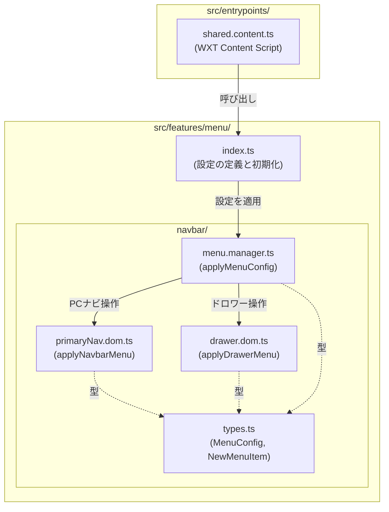

# navbar モジュール

## 概要

Moodle のナビゲーションメニューに対して、項目の非表示と追加を行う。PC表示のトップバーとモバイル表示のドロワーはマークアップが大きく異なるため、その差をアダプターの関数（`applyNavbarMenu` と `applyDrawerMenu`）の中に閉じ込め、呼び出し側が表示モードを意識せず同じ設定で両方を操作できるようにする。



## 関連

- 資料: [`docs/moodle/navbar.md`](../../moodle/navbar.md) — 操作対象のDOM構造とセレクタ。アダプターを触る前に読む
- 参考: [`clock.md`](./clock.md) — 同じナビゲーションメニューに載るバッジ。あちらは Shadow DOM へ Svelte を注入する別方式
- 参考: [`countdownBadge.md`](./countdownBadge.md) — 同上
- 使う: [`../moodle/menuItems.md`](../moodle/menuItems.md) — トップバーのリストのセレクタ `NAVBAR_CONTAINER_SELECTOR`
- 使う: [`../utils/settings.md`](../utils/settings.md) — 設定の取得。参照するのは entrypoint のみで、機能側は参照しない

## 対象ファイル

| パス | 役割 |
|---|---|
| `src/features/menu/navbar/types.ts` | `MenuConfig` / `NewMenuItem` の型定義 |
| `src/features/menu/navbar/menu.manager.ts` | `applyMenuConfig`。非表示用のスタイルを入れ、両方のアダプターへ設定を渡す |
| `src/features/menu/navbar/primaryNav.dom.ts` | `applyNavbarMenu`。PC表示のトップバーを操作する |
| `src/features/menu/navbar/drawer.dom.ts` | `applyDrawerMenu`。モバイル表示のドロワーを操作する |
| `src/features/menu/index.ts` | 設定を受け取り、`applyMenuConfig` へ渡す |
| `src/entrypoints/shared.content.ts` | 設定を読み、`initMenu` へ渡す |

## インターフェース

```ts
// types.ts
export interface NewMenuItem {
  text: string;
  href: string;
  newTab?: boolean;
}

export interface MenuConfig {
  hidden?: string[];
  items?: NewMenuItem[];
}
```

```ts
// menu.manager.ts
export function applyMenuConfig(config: MenuConfig): void;
```

```ts
// primaryNav.dom.ts
export function applyNavbarMenu(config: MenuConfig): void;
```

```ts
// drawer.dom.ts
export function applyDrawerMenu(config: MenuConfig): void;
```

```ts
// index.ts
export function initMenu(config: MenuConfig): void;
```

`initMenu` は受け取った設定をそのまま `applyMenuConfig(config)` へ渡す。

呼び出し側（`src/entrypoints/shared.content.ts`）での使い方:

```ts
const menuConfig = await menuSetting.getValue();
initMenu(menuConfig);
```

設定の中身は次の形になる。

```ts
{
  hidden: ["Office365", "Google", "旧Moodle"], // 並びは働きに関わらない
  // 並べた順にメニューへ足す
  items: [
    {
      text: "シラバス",
      href: "https://example.com/syllabus",
      newTab: true,
    },
  ],
}
```

## 処理の流れ

### applyMenuConfig

1. `applyStyleSheet("mimo-menu-style", "[data-mimo-hidden] { display: none !important; }")` を呼ぶ
2. `applyNavbarMenu(config)` を呼ぶ
3. `applyDrawerMenu(config)` を呼ぶ

### アダプター共通

- 呼ばれた時にコンテナを1度だけ探す。見つからなければ何もしない
- `config.hidden` の各文字列について項目を隠し、その後で `config.items` の各要素を足す

### トップバー（primaryNav.dom.ts）

コンテナのセレクタ: `NAVBAR_CONTAINER_SELECTOR`（`nav.navbar ul.more-nav, nav.navbar ul.navbar-nav`）

**hideItem**

1. `:scope > li.nav-item` を走査し、照合にヒットした要素へ `data-mimo-hidden="true"` を付ける
2. `.dropdown-menu a.dropdown-item` を走査し、同様に処理する

**insertItem**

1. `<li class="nav-item" role="none">` を作り、中へ `<a role="menuitem" class="nav-link">` を入れる
2. `newTab` が true なら `target="_blank"` と `rel="noopener noreferrer"` を付ける
3. `li.dropdownmoremenu` があればその前へ、無ければ末尾へ追加する

### ドロワー（drawer.dom.ts）

コンテナのセレクタ: `#theme_boost-drawers-primary .drawercontent .list-group, #theme_boost-drawers-primary .list-group`

ドロワーでは項目が `li` ではなく `a.list-group-item` としてコンテナの直接の子に並ぶ。アコーディオンの中身は `.collapse` 要素として兄弟位置に置かれる。

**hideItem**

照合に使う値（`data-key`、href、正規化したテキスト）は、隠す対象を回す前に項目ごとに1度だけ読む。テキストの正規化は要素の複製を伴い、対象の数だけ繰り返すと重いため。

1. コンテナの直接の子のうち `.collapse` を持たない要素を走査し、ヒットしたら `data-mimo-hidden="true"` を付ける
2. ヒットした要素がアコーディオンのトグルなら、対応する `.collapse` 要素にも同じ属性を付ける。トグルの判定は次のいずれかを満たすこと
   - `data-toggle="collapse"` または `data-bs-toggle="collapse"` を持つ
   - `data-target` または `data-bs-target` を持つ
   - 次の兄弟要素が `.collapse` を持つ
3. 対応する `.collapse` 要素は、`data-target`（または `data-bs-target`）のセレクタ → 次の兄弟要素 → `aria-controls` の id、の順に探す
4. `.collapse a.list-group-item` を走査し、ヒットしたら同様に属性を付ける

**insertItem**

1. `<a class="list-group-item list-group-item-action">` を作る
2. `newTab` の扱いはトップバーと同じ
3. 末尾へ追加する

### 照合ロジック

両アダプターとも同じ順序で評価し、ヒットした時点で一致とみなす。

1. `data-key` 属性 — 完全一致、または双方を小文字化しての一致
2. `href` — 部分一致。小文字化した比較も行う
3. `textContent` — 部分一致。前後の空白を除き、小文字化して比較する

アダプターごとの違い:

| | トップバー | ドロワー |
|---|---|---|
| 入れ子を持つ要素 | `.dropdown-menu` を内包する場合、主リンク（`:scope > a, a.nav-link, a`）のみを照合対象にする。内包しない場合は要素内の全 `<a>` の href を照合する | `.collapse` クラスを持つ要素そのものは照合対象外 |
| href の除外 | なし | `#` または `#` 始まりの href は照合しない |
| テキストの正規化 | ドロップダウンでは主リンクのテキストのみ使う | 子要素を持たない場合は `textContent` をそのまま使う。持つ場合は `.collapse` / `.sr-only` / `.visually-hidden` を除いたクローンから取得し、「折りたたむ」「展開する」を除去してから比較する |

## 決めごと

- **非表示は DOM から削除せず、`data-mimo-hidden="true"` 属性と CSS で行う。** Moodle 内部のスクリプト（Bootstrap / YUI）が要素の存在を前提にしているため、物理削除すると壊れる
- **非表示用のスタイルは [`applyStyleSheet`](../utils/styleSheet.md) で動的に挿入する。** `src/assets/global.css` には置かない
- **`href` と `textContent` の照合は部分一致にする。** 完全一致にすると表記ゆれで漏れるため。代償として意図しない項目にヒットし得るので、`hidden` へ渡す文字列は十分に具体的なものを選ぶ
- **入れ子を持つ親要素の照合に、サブ項目のテキストを含めない。** 含めるとサブ項目の名前を指定した時に親ごと消える
- **操作対象は主ナビゲーションに限る。** 通知・メッセージ・ユーザープロフィールなどのユーザーナビゲーションは対象外
- **足す項目は位置を持たず、並びの末尾へ入る。** 位置を指定する設定は [`../settings/menuFields.md`](../settings/menuFields.md) が編集させないため、指定の処理も持たない
- **設定の適用は1度だけ行い、DOM の変化を待たない。** `initMenu` は `document_idle` の [`shared.content.ts`](../../../src/entrypoints/shared.content.ts) からだけ呼ばれ、その時点でメニューは描画済みになっている
- **設定は entrypoint が読み、`initMenu` が引数で受け取る。** このモジュールは設定の保存場所も形式も参照しない
