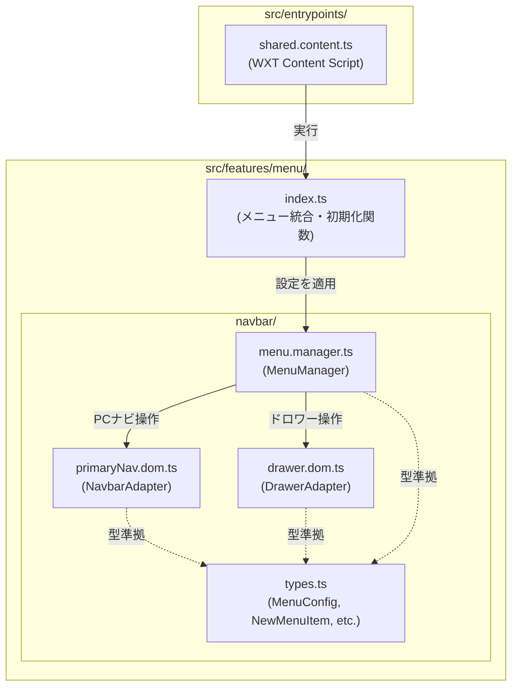

# Navbar & Drawer Navigation Module

Moodle 4.5 のナビゲーションメニュー（PC表示時のトップバーおよびモバイル表示時のドロワー）を抽象化し、要素の非表示化や新規項目の挿入を行うためのモジュールです。

## アーキテクチャ

呼び出し元（エントリーポイントやメニュー統合機能）は内部のDOM操作用アダプターを意識することなく、`MenuManager` を通じてナビゲーション全体を一括操作できます。



## ファイル構成

| ファイル | 役割 |
|---|---|
| `menu.manager.ts` | ナビゲーションメニュー全体を統括するマネージャー。各アダプター（PC・モバイル）に対して一括で非表示・項目追加を実行する |
| `primaryNav.dom.ts` | PC表示時（`nav.navbar`）のDOM構造を操作する `NavbarAdapter` |
| `drawer.dom.ts` | モバイル表示時（`#theme_boost-drawers-primary`）のドロワーDOM構造を操作する `DrawerAdapter` |
| `types.ts` | `MenuAdapter`, `MenuConfig`, `NewMenuItem` などのインターフェース定義 |
| `menu.md` | Moodle実画面から採取したDOM構造の詳細リファレンスとセレクタ一覧 |

## 主な使い方

```typescript
import { MenuManager } from "./navbar/menu.manager";
import type { MenuConfig } from "./navbar/types";

const config: MenuConfig = {
  // 非表示にする項目名またはリンクURL
  hidden: [
    "Office365",
    "Google",
    "eラーニング",
    "Scilets",
    "三重創生ファンタジスタ",
    "旧Moodle",
  ],
  // 新規追加するリンク項目
  items: [
    {
      text: "シラバス",
      href: "https://example.com/syllabus",
      newTab: true,
      position: { target: "マイコース", where: "after" },
    },
  ],
};

const menuManager = new MenuManager();
menuManager.applyConfig(config);
```

## 関連ドキュメント

- [menu.md](./menu.md): Moodle 4.5 のナビゲーションバーおよびドロワーのHTML構造・セレクタの詳細リファレンス
